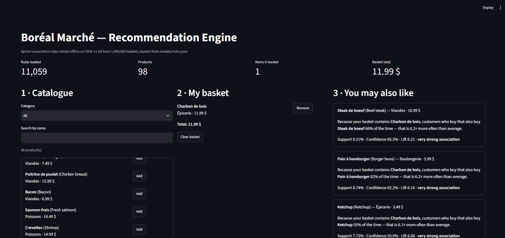
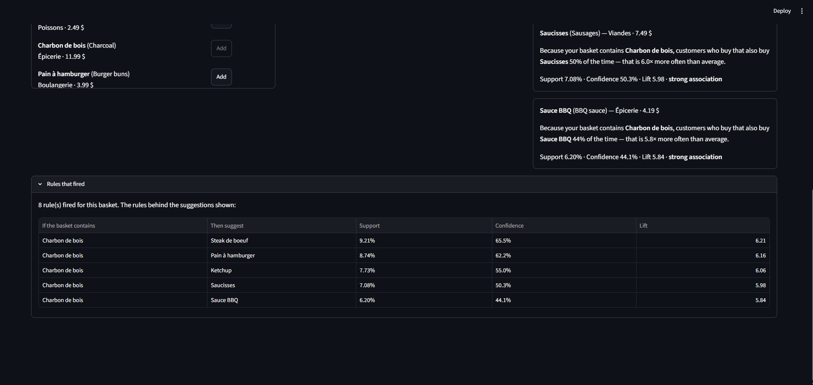
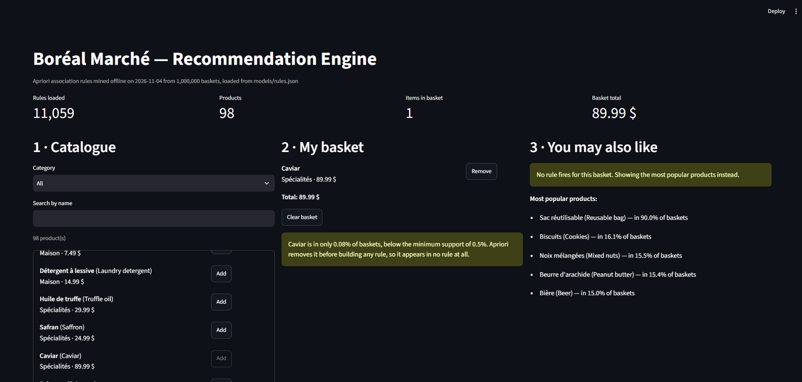
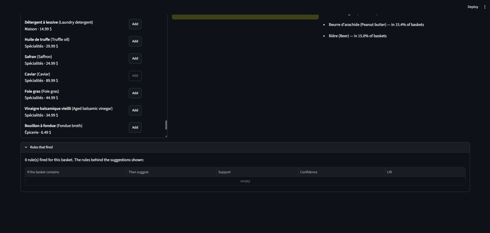
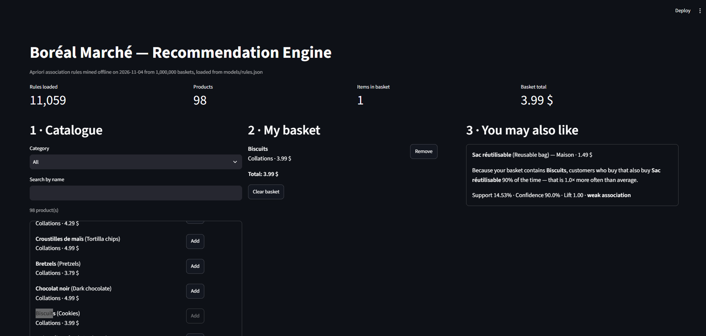
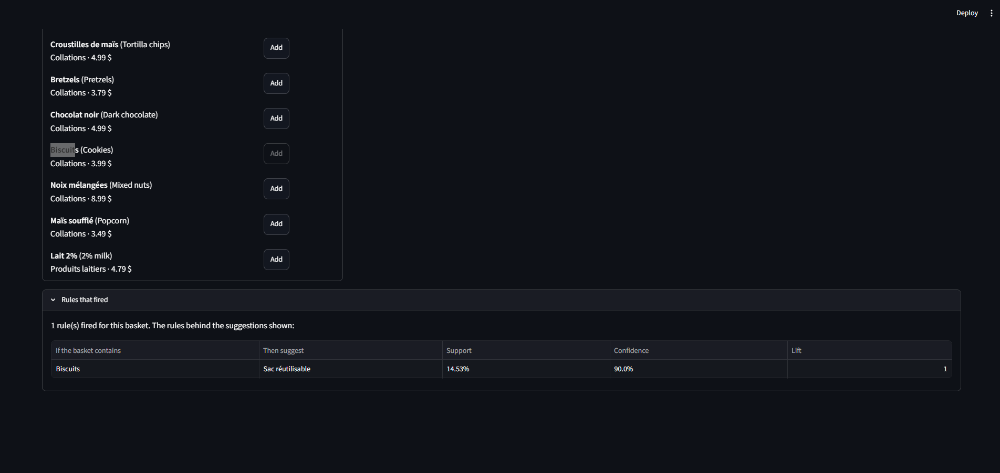

# Boréal Marché: Recommendation Engine with Association Rules

Final project for 420-975-VA Unsupervised Learning. One year of Boréal Marché transactions (1,000,000 baskets, 8,379,837 rows, 98 products) is mined with the Apriori algorithm (`mlxtend`). The resulting rules feed a Streamlit application that answers one question:

> "Given what this customer has already put in their basket, what should we suggest next, and why?"

Mining runs **offline** in the notebook and writes the rules to `models/rules.json`. The application runs **online**, only loads that file, and never calls Apriori.

## Repository structure

```
USML_Project_KaHoChan/
├── README.md
├── requirements.txt
├── data/
│   ├── transactions.zip     # TransactionID, Date, CustomerID, Item (36 MB zipped)
│   └── products.csv         # Item (FR), Item_EN, Category, Price (98 products)
├── notebooks/
│   └── 01_mining.ipynb      # executed, outputs visible
├── models/
│   ├── rules.json           # rules mined offline
│   └── metadata.json        # thresholds, mining date, metrics
├── app/
│   └── streamlit_app.py     # the application
├── reports/
│   └── benchmark.md         # timing and memory measurements
└── screenshots/             # screenshots of the application
```

## Environment setup

Requirements: Python 3.14 (tested with 3.14.4). All package versions are pinned in `requirements.txt`.

With conda:

```bash
conda create -n boreal python=3.14
conda activate boreal
pip install -r requirements.txt
```

With venv (Windows):

```bash
python -m venv .venv
.venv\Scripts\activate
pip install -r requirements.txt
```

The notebook kernel is registered with:

```bash
python -m ipykernel install --user --name boreal --display-name "Python (boreal)"
```

## Data

`data/transactions.zip` is committed to the repository. Pandas reads the archive directly, so no manual unzipping is required:

```python
tx = pd.read_csv("data/transactions.zip", usecols=["TransactionID", "Item"])
```

The unzipped `transactions.csv` (about 304 MB) exceeds GitHub's 100 MB file limit and is excluded by `.gitignore`.

Note: in `products.csv` the `Item` column holds the **French** product name and `Item_EN` the English one. Transactions use the French names, so `Item` is the join key.

## Running the project

1. **Mining (offline).** `notebooks/01_mining.ipynb` is run top to bottom. It builds the boolean basket table, runs Apriori at several `min_support` values, evaluates the rules, performs the seasonal analysis, and writes `models/rules.json` and `models/metadata.json`.
2. **Application (online).** From the repository root:

   ```bash
   streamlit run app/streamlit_app.py
   ```

## Results

Full measurements are in [`reports/benchmark.md`](reports/benchmark.md).

**Thresholds chosen:** min_support 0.005 (0.5%), min_confidence 0.2, lift > 1, one product on the THEN side, `low_memory=True`.

| | Value |
|---|---|
| Frequent itemsets (min_support 0.005) | 7,106 |
| Rules before the lift filter (confidence ≥ 0.2) | 28,433 |
| Rules kept for the app (`models/rules.json`) | 11,059 |
| Products that can ever be recommended | 58 of 98 (59%) |
| Apriori with default settings at 0.005 | MemoryError (72.6 GiB requested), then 562.4 s / 108 GB virtual memory on a second run |
| Apriori with `low_memory=True` at 0.005 | 26.2 s, 115 MB peak memory |

**Confidence vs lift (simple rules, one product on each side):**
- Top 10 by confidence: 10 of 10 suggest Sac réutilisable (confidence ≈ 0.90, lift ≈ 1.00). The bag is in 90% of all baskets.
- Top 10 by lift: 0 of 10 suggest the bag. The strongest rule is Fromage à raclette ↔ Bouillon à fondue (lift 10.17).
- The lift > 1 filter removed 1,442 rules, all of them suggesting Sac réutilisable.

**Seasonal analysis (summer = June–August, winter = December–February):**
- Summer: 252,474 baskets, 335 simple rules with lift > 1. Winter: 246,965 baskets, 338 rules.
- 274 rules hold in both seasons, 61 only in summer, 64 only in winter.
- 30 of the 354 year-round rules do not hold in winter (for example Bière → Charbon de bois).

*Main findings: (to be written)*

## Edge cases tested

All cases were checked with Streamlit's `AppTest` on the final `models/rules.json`; the rare-product and no-rule cases also appear in the screenshots below.

| Situation | Expected behaviour | Result |
|---|---|---|
| Empty basket | Clear message and fallback to popular products | Pass: "No rule can fire on an empty basket (cold start)", then the 5 most popular products |
| No rule fires | Explicit message, then fallback | Pass: basket with only Caviar shows "No rule fires for this basket", then the popular products |
| Item already in the basket | Never suggested again | Pass: basket Charbon de bois + Steak de boeuf + Pain à hamburger suggests Ketchup, Saucisses, Sauce BBQ, Relish, Bière (no overlap) |
| Two rules suggest the same item | The rule with the higher lift is kept | Pass: in the same basket, 7 rules suggest Ketchup; the one with the highest lift (6.69) is shown |
| A very rare product | Explanation of why it appears in no rule | Pass: "Caviar is in only 0.08% of baskets, below the minimum support of 0.5%…" |

## Screenshots

**BBQ basket** (Charbon de bois): strong suggestions such as Steak de boeuf, lift 6.21.




**Rare product** (Caviar): rare-product warning, no rule fires, fallback to popular products.




**Frequent but independent product** (Biscuits): the only suggestion is Sac réutilisable at lift 1.0, labelled weak.




## Limitations

*To be completed.*

## Ethical and legal framing

*To be completed: Law 25 explainability, correlation vs causation (the famous retail example found in the rules), and reinforcement bias.*

*Fact for the beer-and-diapers paragraph: the rule Couches → Bière is in the kept rules with support 0.031, confidence 0.366 and lift 2.43 (beer is in 15.0% of all baskets).*
